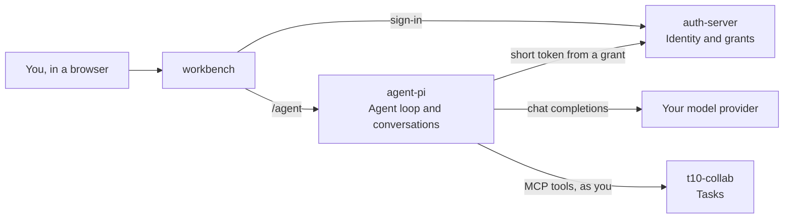

# t10 quickstart

Run a small multi-user agent platform on your machine with Docker. You sign in to a web client and ask an agent to do something. It calls real tools as you, and the results are stored in a real service.

This repo holds only the instructions and the Compose file. Each service builds from its own repo, at a pinned commit.

> **Local use only.** This stack runs in dev mode with secrets that are published in this repo. Its ports are bound to `127.0.0.1`. Don't expose them to a network.

## What runs



| Service | Role | Address |
| --- | --- | --- |
| `workbench` | Web client | <http://127.0.0.1:18083> |
| `auth-server` | Users, tenants, tokens and agent grants | <http://127.0.0.1:18081> |
| `agent-pi` | The agent loop, and the conversations | <http://127.0.0.1:19800> |
| `t10-collab` | The agent's tools, an MCP server for tasks | <http://127.0.0.1:18082> |
| Postgres | Storage for `auth-server`, `workbench` and `t10-collab` | Not published |

`agent-pi` keeps conversations in SQLite on its own volume.

When the model calls a tool, `agent-pi` mints a short-lived token from a grant tied to your conversation. `t10-collab` refuses anything else, including your own sign-in token, so the agent can do no more than you can.

## Before you start

- Docker with Compose 2.24.4 or later
- Ports `18081`, `18082`, `18083` and `19800` free
- An API key for an OpenAI-compatible model that supports tool calling

## Run it

```sh
git clone https://github.com/xiant10/t10-quickstart.git
cd t10-quickstart
cp .env.example .env
```

Set your provider in `.env`, then start the stack. The first build takes a few minutes.

```sh
docker compose up -d --build --wait
```

The one-shot `seed` service exits after creating the sample user, which is expected.

Open <http://127.0.0.1:18083>, using `127.0.0.1` rather than `localhost`, and sign in:

| | |
| --- | --- |
| Username / Email | `ada@acme.example` |
| Password | `change-me-enterprise-admin` |

## Things to try

Start a new conversation and send these one at a time:

1. `Create a task for me titled "Renew the Acme contract" with high priority.`
2. `Which tasks do I have? Add a comment "checked" to the first one, then tell me what you did.`

Then check that it really happened, without trusting the agent's reply:

```sh
docker compose exec postgres psql -U t10 -d collab \
  -c "select kind, actor_grant_id, at from collab.events order by at"
```

Each row is a write, and `actor_grant_id` shows the grant it ran under.

Restart the harness, then reopen the conversation. It's still there.

```sh
docker compose restart agent-pi
```

## Check it without a model key

`check.sh` starts a separate copy with a scripted model, runs one tool call, and removes that copy. Stop your own stack first if it is running, because both use the same ports:

```sh
docker compose stop
./check.sh
docker compose up -d
```

## Choose a model

Any endpoint that serves OpenAI-style `/chat/completions`, with streaming and tool calls, should work. `FAST_MODEL_ID` serves voice, which this stack doesn't run, and `SMART_MODEL_ID` serves chat, so they can be the same model.

| Provider | `LLM_BASE_URL` | Tested |
| --- | --- | --- |
| Alibaba Cloud DashScope | `https://dashscope.aliyuncs.com/compatible-mode/v1` | Yes, with `qwen-flash` |
| OpenAI | `https://api.openai.com/v1` | No |
| A local server such as Ollama | `http://host.docker.internal:11434/v1` | No. Set `LLM_API_KEY` to any value |

Multi-step requests depend on the model. A weak model may skip a step or stop to ask first.

There's no spending limit in this stack, so set one at your provider.

## Stop

```sh
docker compose stop        # Keeps containers and data
docker compose down -v     # Deletes everything
```

## What's left out

| Not here | What it adds |
| --- | --- |
| LiveKit and a voice worker | Live calls. The **Call** button in `workbench` doesn't work in this stack |
| `ai-gateway` | Several replicas, model aliases, provider fallback, quotas and model-call audit |
| Other MCP servers (e.g. weather) | Additional domain tools. This stack wires up `t10-collab` for task management |

## Troubleshooting

| Symptom | Cause |
| --- | --- |
| `copy .env.example to .env and set it` | `.env` is missing, or a value in it is empty |
| Sign-in fails with a redirect error | Open `http://127.0.0.1:18083`, not `localhost` |
| `port is already allocated` | Something else holds one of the ports. For `check.sh`, stop your own stack first |
| The reply never arrives | Check `docker compose logs agent-pi` for an error from your provider |
| The agent says it did something, but no row appears | The model didn't call a tool. Try a stronger model |

## Working on the services

To build from your own checkouts, put them beside this folder, using the repo names as folder names:

```sh
docker compose -f docker-compose.yml -f compose.dev.yml up -d --build --wait
```
