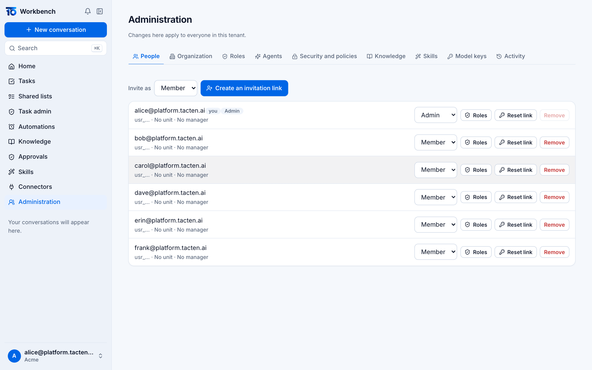
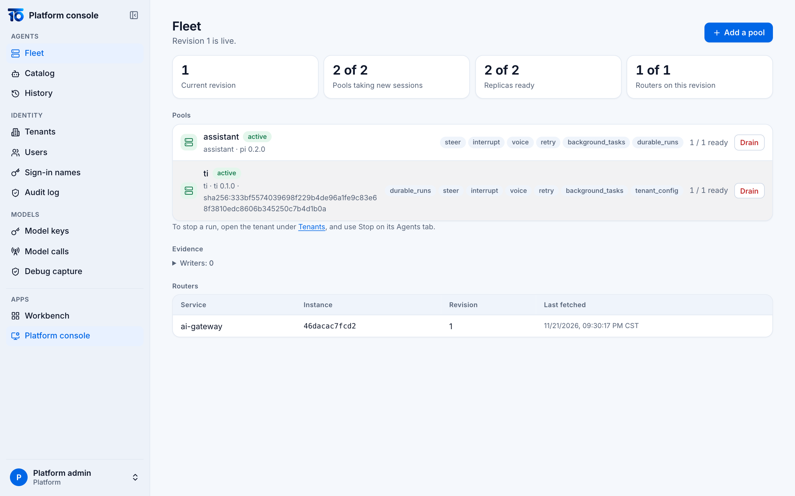
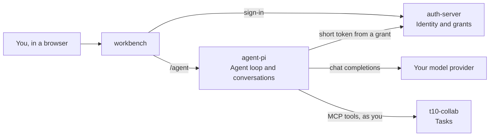

# t10 Quickstart

t10 is a platform for running AI agents for a team. Each person signs in to a **tenant**, chats with an agent in a browser, and the agent does real work for them, such as creating tasks, searching knowledge and answering by voice, with exactly the permissions of the person who asked.

This repository is the fastest way to see it:

- **[Try the hosted demo](#try-the-hosted-demo)**: nothing to install. Sign in and use it.
- **[Run it yourself](#run-it-yourself)**: the same platform on your machine with Docker Compose, in about five minutes.

| | Hosted demo | Light stack (`compose.yml`) | Full stack (`compose.all.yml`) |
| --- | --- | --- | --- |
| Install | Nothing | Docker | Docker |
| Model key needed | No | Yes | Yes |
| What you get | The whole platform, shared with other visitors | Workbench, sign-in, tasks and one agent | Every component: the platform console, `ai-gateway`, `agent-ti`, knowledge, automations and live calls |
| Platform console | No | No | Yes |

---

## Try the hosted demo

A hosted demo of the whole platform is up at <https://t10-workbench.platform.tacten.ai>. Sign in with any account below to chat with the agents, work on tasks, search knowledge, send a voice message, or start a live call.

| Sign-in name | Password | Role in tenant Acme | Stands for |
| :--- | :--- | :--- | :--- |
| `alice@platform.tacten.ai` | `f01097f5c486` | Tenant admin | manages members, roles and agent settings |
| `bob@platform.tacten.ai` | `35f33837c6a6` | Member | sales |
| `carol@platform.tacten.ai` | `93d81d624e30` | Member | support |
| `dave@platform.tacten.ai` | `9e5266e3927e` | Member | finance |
| `erin@platform.tacten.ai` | `799c934a1f7a` | Member | engineering |
| `frank@platform.tacten.ai` | `f292f01853d6` | Member | facilities |

- **Shared and public.** Everyone who reads this can use these accounts at once, and they all see the same tenant, **Acme**. Don't enter anything you want to keep private. Please don't change a password.
- **Not always on.** The demo runs on one machine and is up only while that machine is. It may be reset, and its passwords may change.
- **Language.** If the pages open in Chinese, press **English** on the account page. Every app follows it.
- **Voice.** Voice messages and live calls need a microphone, and your browser will ask for access.
- **Admin access isn't included.** The platform administrator and the console are not part of the shared demo. To see them, [run the full stack](#run-everything).

### What you'll see

**As a tenant admin** (`alice`): the workbench's Administration page, where an admin invites people, sets their roles and manages the tenant's agents, policies and knowledge.



**As a platform administrator**: the platform console, where every tenant, user, agent pool and model call is managed. This is its Fleet page: the agent pools, how many replicas are ready, and the routing revision that is live. It comes with the [full stack](#run-everything).



**Want to talk it through, or see a guided demo?** Write to [hi@tacten.ai](mailto:hi@tacten.ai).

---

## Run it yourself

### What you need

- Docker with Compose 2.24.4 or later
- Ports `28081`, `28082`, `28083` and `29800` free
- An API key for an OpenAI-compatible model that supports tool calling. [Choose a model](#choose-a-model) lists providers.

### Start it

```sh
git clone https://github.com/xiant10/t10-quickstart.git
cd t10-quickstart
cp .env.example .env
```

Set your model provider credentials in `.env`, then start the stack:

```sh
docker compose up -d --wait
```

Docker Compose loads `compose.yml`, which pulls pre-built multi-architecture images from GitHub Container Registry (`ghcr.io`) and seeds the default admin account. Each image is pinned by the commit it was built from, and each [release tag](https://github.com/xiant10/t10-quickstart/tags) marks a set that was checked together.

The one-shot `seed` service exits after creating the sample tenant and administrator, which is expected.

### Sign in

Open <http://127.0.0.1:28083> (use `127.0.0.1`, not `localhost`) and sign in as the default administrator:

| Field | Value | Notes |
| :--- | :--- | :--- |
| **Workbench** | <http://127.0.0.1:28083> | Use `127.0.0.1`, not `localhost` |
| **Auth server** | <http://127.0.0.1:28081> | Identity and token minting |
| **Username** | `felix@acme.example` | The bootstrap administrator |
| **Password** | `change-me-enterprise-admin` | Set by `AUTHCTL_PASSWORD` |
| **Tenant** | `ten_acme` | Display name: `Acme` |
| **Roles** | Platform admin and tenant admin | Unrestricted access to all features |

This is a local stack with development secrets. Don't expose it to a network you don't trust.

### Things to try

Start a new conversation and send these one at a time:

1. `Create a task for me titled "Renew the Acme contract" with high priority.`
2. `Which tasks do I have? Add a comment "checked" to the first one, then tell me what you did.`

Then check that it really happened, without trusting the agent's reply:

```sh
docker compose exec postgres psql -U t10 -d collab \
  -c "select kind, actor_grant_id, at from collab.events order by at"
```

Each row is a write, and `actor_grant_id` shows the grant it ran under.

Restart the harness, then reopen the conversation. It's still there.

```sh
docker compose restart agent-pi
```

### Stop

```sh
docker compose stop        # Keeps containers and data
docker compose down -v     # Deletes everything
```

### Run everything

To run every platform component, with `ai-gateway`, `agent-ti`, the console, knowledge, automations and live calls, use `compose.all.yml`:

```sh
docker compose -f compose.all.yml up -d --wait
```

> **Using `compose.all.yml`?** Add `-f compose.all.yml` to every `docker compose` command in this README. The ports it publishes are listed at the top of that file, and the platform console is at <http://127.0.0.1:28020>. Model calls go through `ai-gateway`, which keeps an audit of them in Postgres for the console's **Model calls** page. `FAST_MODEL_NAME` and `SMART_MODEL_NAME` in `.env` name your provider's models.

The light stack leaves out the following, and the full stack adds them:

| Not in the light stack | What it adds |
| --- | --- |
| LiveKit and a voice worker | Live calls. The **Call** button in `workbench` doesn't work in the light stack |
| `ai-gateway` | Several replicas, model aliases, provider fallback, quotas and model-call audit |
| Other MCP servers (such as weather) | Additional domain tools. The light stack wires up `t10-collab` for task management |

---

## How it works



| Service | Role | Address |
| --- | --- | --- |
| `workbench` | Web client | <http://127.0.0.1:28083> |
| `auth-server` | Users, tenants, tokens and agent grants | <http://127.0.0.1:28081> |
| `agent-pi` | The agent loop, and the conversations | <http://127.0.0.1:29800> |
| `t10-collab` | The agent's tools, an MCP server for tasks | <http://127.0.0.1:28082> |
| Postgres | Storage for `auth-server`, `workbench` and `t10-collab` | Not published |

`agent-pi` keeps conversations in SQLite on its own volume.

When the model calls a tool, `agent-pi` mints a short-lived token from a grant tied to your conversation. `t10-collab` refuses anything else, including your own sign-in token, so the agent can do no more than you can.

---

## Configure it

### Choose a model

Any endpoint that serves OpenAI-style `/chat/completions`, with streaming and tool calls, should work. `FAST_MODEL_ID` serves voice, which the light stack doesn't run, and `SMART_MODEL_ID` serves chat, so they can be the same model.

| Provider | `LLM_BASE_URL` | Tested |
| --- | --- | --- |
| Alibaba Cloud DashScope | `https://dashscope.aliyuncs.com/compatible-mode/v1` | Yes, with `qwen-flash` |
| OpenAI | `https://api.openai.com/v1` | No |
| A local server such as Ollama | `http://host.docker.internal:11434/v1` | No. Set `LLM_API_KEY` to any value |

Multi-step requests depend on the model. A weak model may skip a step or stop to ask first.

There's no spending limit in this stack, so set one at your provider.

### Language

To give everyone one language, set `T10_LANGUAGES=zh-Hans` in `.env` (comma-separate several, the default first). Unset, people choose English or Simplified Chinese on their account page, and every app follows it.

---

## Manage users

### Add a person

**In the workbench.** Sign in as an admin at <http://127.0.0.1:28083>, open **Administration** in the sidebar, then **People**. Choose **Member** or **Admin** under **Invite as**, press **Create an invitation link**, and send the link to the person, who sets their own password. On the same page each person has **Roles**, **Reset link** and **Remove**.

**From the command line.** `authctl add-user` creates a user directly in PostgreSQL:

```sh
docker compose exec auth-server authctl add-user \
  --username="bob@acme.example" \
  --tenant-id="ten_acme" \
  --role="member"
```

You are prompted for the password, or set `AUTHCTL_PASSWORD`.

### Sample accounts for testing roles

To create sample accounts across several tenants, so you can test different permission levels:

```sh
docker compose exec auth-server authctl samples-add
```

This creates the following accounts, which all share the password `t10-sample-password`:

| Username | Role & Scope | Password |
| :--- | :--- | :--- |
| `sample-platform` | Platform Admin (access across all tenants) | `t10-sample-password` |
| `sample-acme-admin` | Tenant Admin of `Sample Acme` (`ten_sample-acme`) | `t10-sample-password` |
| `sample-globex-admin` | Tenant Admin of `Sample Globex` (`ten_sample-globex`) | `t10-sample-password` |
| `sample-member` | Regular Member in `Sample Acme` (no admin rights) | `t10-sample-password` |
| `sample-multi` | Member of both `Sample Acme` and `Sample Globex` | `t10-sample-password` |

To remove them when you're finished:

```sh
docker compose exec auth-server authctl samples-remove
```

### Sign in from a script

To mint an OAuth2 bearer token directly, for scripts, tests or command-line tools:

```sh
curl -fsS http://127.0.0.1:28081/v1/token \
  -d grant_type=password \
  -d client_id=t10-mac-client \
  -d username=felix@acme.example \
  -d password=change-me-enterprise-admin \
  -d tenant=ten_acme
```

---

## Check it without a model key

`check.sh` starts a separate copy with a scripted model, sends one turn and one tool call, checks that no identity header reached the model, and removes that copy. `DEV=1 ./check.sh` builds from sibling checkouts instead. Stop your own stack first if it is running, because both use the same ports:

```sh
docker compose stop
./check.sh
docker compose up -d
```

## Troubleshooting

| Symptom | Cause |
| --- | --- |
| `copy .env.example to .env and set it` | `.env` is missing, or a value in it is empty |
| Sign-in fails with a redirect error | Open `http://127.0.0.1:28083`, not `localhost` |
| `port is already allocated` | Something else holds one of the ports. For `check.sh`, stop your own stack first |
| The reply never arrives | Check `docker compose logs agent-pi` for an error from your provider |
| The agent says it did something, but no row appears | The model didn't call a tool. Try a stronger model |

## Working on the services

To build from your own checkouts, put them beside this folder, using the repo names as folder names:

```sh
docker compose -f compose.yml -f compose.dev.yml up -d --build --wait
```

## Contact

Questions, feedback, a guided demo or commercial enquiries: [hi@tacten.ai](mailto:hi@tacten.ai).

## License

Apache License 2.0. See [LICENSE](LICENSE).
